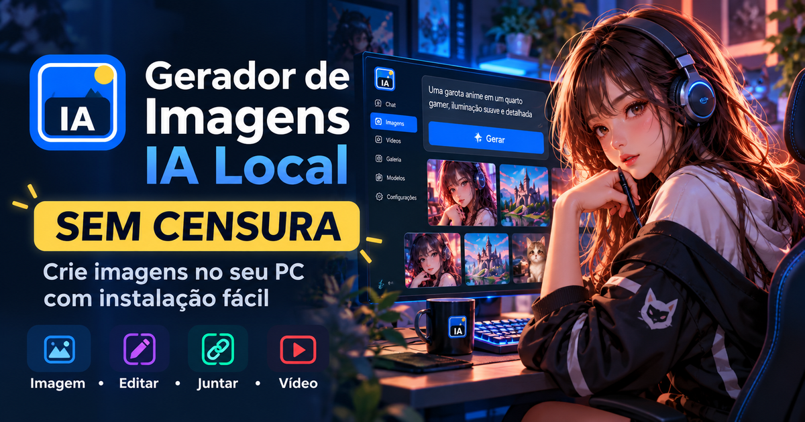

# Gerador de Imagens IA Local — Geração de Imagens Sem Censura no Windows



**Gerador de imagens com IA local sem censura para Windows**, com criação, edição, combinação de imagens, geração de vídeo por IA, galeria, fila, modelos instalados sob demanda e gerenciamento simples pela própria interface.

**Desenvolvido por <a href="https://thall.es" target="_blank" rel="noopener">Thalles Lázaro</a>** • <a href="https://thall.es" target="_blank" rel="noopener">thall.es</a>

<a href="https://youtu.be/YQbrUucNrRE" target="_blank" rel="noopener"></a>

**▶ <a href="https://youtu.be/YQbrUucNrRE" target="_blank" rel="noopener">Assistir ao tutorial completo no YouTube</a>**  
**GitHub oficial:** https://github.com/ThallesLazaro/Gerador-de-Imagens-IA-Local

O projeto foi pensado para quem quer usar IA generativa no próprio computador sem precisar montar manualmente vários backends, comandos e pastas de modelos. A instalação do núcleo é simplificada no Windows e os recursos pesados podem ser ativados depois, diretamente pelo navegador.

> **Foco do projeto:** mídia. O chat existe como apoio para prompts e ideias, mas o objetivo principal é gerar, editar e transformar imagens e vídeos localmente.

## Principais recursos

- **Text-to-Image local** com Qwen Image 2.1 Turbo.
- **Geração de imagens sem censura** quando há uma variante compatível disponível no catálogo.
- **Edição de imagens com IA** usando uma imagem de referência.
- **Merge de imagens** com duas ou mais referências.
- **Text-to-Video e Image-to-Video** com motor de vídeo IA compatível.
- **Vídeo leve com FFmpeg** para composições e movimentos simples.
- **Chat local opcional** para ajudar com prompts e ideias.
- **Galeria local** de imagens e vídeos gerados.
- **Fila de geração** para organizar vários pedidos.
- **Seed reutilizável** para repetir ou variar resultados.
- **Reutilizar geração** restaurando prompt, opções e imagens de referência.
- **Retry automático por falta de memória**, reduzindo a resolução para 75% e depois 50% quando necessário.
- **Mensagens de erro amigáveis** para GPU, Vulkan, RAM, arquivos ausentes e modelos incompatíveis.
- **Progresso e ETA inteligentes**, baseados em etapas reais do backend e histórico de tempo de geração.
- **Logs técnicos completos** com scroll horizontal e sem quebra forçada de linha.
- **Modelos instalados sob demanda**, sem obrigar o usuário a baixar tudo de uma vez.
- **Troca de modelos pela interface**.
- **URLs personalizadas de modelos**.
- **Catálogo editável em `modelos.json`**, sem precisar alterar o código-fonte.
- **Carregar e descarregar o modelo de chat da memória** pela interface.
- **Reutilização de arquivos compartilhados** quando Chat e Imagem usam o mesmo encoder.
- **Q4_K como padrão recomendado** para reduzir falhas de memória em mais computadores.
- Variantes maiores, como Q5_K, Q6_K e Q8_0, continuam disponíveis para quem quiser priorizar qualidade.

## Geração de imagens sem censura

Um dos diferenciais do projeto é priorizar **modelos sem censura** quando existe uma variante compatível disponível. A interface identifica a variante escolhida em **Recursos IA** e o catálogo `modelos.json` pode ser editado para trocar modelos e URLs sem alterar o código-fonte.

O comportamento final depende do modelo e do motor selecionados. Nem toda família de modelos possui uma variante sem censura equivalente, por isso o projeto não troca ou rotula automaticamente um modelo sem confirmar essa característica no catálogo.

## Por que este projeto é diferente?

Muitas ferramentas de IA local exigem instalar Python, clonar repositórios, configurar ambientes, baixar modelos manualmente, descobrir nomes de arquivos corretos, ajustar comandos e resolver dependências uma por uma.

O **Gerador de Imagens IA Local** tenta reduzir esse trabalho:

1. execute `INSTALAR.bat` para preparar o núcleo;
2. execute `ABRIR.bat` para abrir a interface;
3. escolha em **Recursos IA** quais motores e modelos deseja instalar.

Os modelos grandes não fazem parte do ZIP do projeto. Eles são baixados somente quando o usuário decide ativá-los.

## Instalação no Windows

### 1. Baixe e extraia o projeto

Extraia a pasta em um local com espaço suficiente para os modelos.

### 2. Execute o instalador

Abra:

```text
INSTALAR.bat
```

O instalador prepara o núcleo e instala o Node.js LTS automaticamente pelo `winget` quando necessário.

### 3. Abra o aplicativo

Execute:

```text
ABRIR.bat
```

O servidor local será iniciado e a interface abrirá automaticamente no navegador.

### 4. Ative os recursos que deseja usar

Na interface, abra **Recursos IA** e escolha entre:

- Chat local;
- Qwen Image;
- Vídeo leve;
- Vídeo IA.

Cada recurso pode ser instalado, reparado ou removido separadamente.

## Modos disponíveis

### Imagem

Cria uma imagem a partir de um prompt de texto.

### Editar

Recebe uma imagem de referência e uma instrução dizendo o que deve ser alterado.

### Juntar

Usa duas ou mais imagens como referências para criar uma nova composição.

### Vídeo

Permite usar um motor de vídeo IA para Text-to-Video ou Image-to-Video. Também existe um modo leve baseado em FFmpeg.

### Conversar

Chat local opcional para ajudar com prompts, ideias e preparação de conteúdo para imagem e vídeo.

## Retry inteligente quando falta memória

Modelos de imagem podem exigir muita memória, principalmente em resoluções maiores, edição e merge com várias referências.

Quando o backend identifica falta de memória da GPU, o projeto pode tentar novamente automaticamente:

1. resolução original;
2. 75% da largura e altura;
3. 50% da largura e altura.

O prompt, a seed, as imagens enviadas e as demais opções são preservados entre as tentativas.

O comportamento pode ser alterado em **Opções → Se faltar memória na GPU**.

## Progresso e previsão de tempo

A porcentagem de geração não depende apenas de um relógio artificial. O frontend acompanha eventos do backend, como:

- carregamento dos modelos;
- processamento do prompt;
- pré-processamento das imagens de referência;
- geração/amostragem;
- decodificação do resultado;
- salvamento;
- geração de frames de vídeo;
- codificação de MP4.

O tempo real de gerações anteriores também é usado para melhorar as próximas estimativas.

Quando uma geração ultrapassa a previsão inicial, a interface não fica presa em `96% • 0s`. Ela passa a informar que está levando mais tempo que o previsto e continua mostrando a etapa real em execução.

## Modelos de IA

O catálogo de modelos fica em:

```text
modelos.json
```

Isso permite trocar URLs, nomes de arquivos, variantes e repositórios sem procurar links espalhados pelo código.

### Qwen Image

O projeto usa o pipeline do Qwen Image com componentes separados quando necessário, incluindo:

- denoiser Qwen Image Turbo;
- encoder Qwen/AtomicChat configurado no catálogo, incluindo variantes sem censura quando disponíveis;
- projetor visual `mmproj` para referências;
- VAE.

O perfil padrão usa quantização **Q4_K**, priorizando compatibilidade e menor consumo de memória. Q5_K, Q6_K e Q8_0 podem ser selecionados manualmente.

### URL personalizada

Usuários avançados também podem informar URLs próprias para modelos compatíveis diretamente em **Recursos IA**.

## Gerenciamento de memória

O projeto tenta evitar manter recursos pesados carregados sem necessidade:

- **Chat:** pode permanecer carregado e pode ser descarregado manualmente.
- **Imagem:** é executada sob demanda.
- **Vídeo IA:** é executado sob demanda.
- **FFmpeg:** é chamado apenas quando necessário.

Na aba **Recursos IA**, o usuário pode verificar qual modelo está selecionado e o estado do recurso.

## Galeria e histórico

A conversa abre diretamente nas mensagens mais recentes. Para não renderizar centenas de imagens e vídeos de uma vez, o histórico usa **carregamento progressivo reverso**: inicialmente entram apenas as 24 mensagens mais recentes e, ao subir até o topo, o lote anterior é carregado automaticamente sem deslocar a leitura. As imagens usam lazy loading, enquanto os arquivos completos continuam armazenados localmente na galeria/IndexedDB.

A galeria guarda as gerações no navegador e permite:

- pesquisar por prompt;
- filtrar imagens e vídeos;
- reutilizar uma geração;
- recuperar imagens de referência utilizadas;
- usar a mesma seed;
- editar uma imagem gerada;
- transformar uma imagem em vídeo;
- excluir resultados.

## Estrutura do projeto

```text
Gerador-de-Imagens-IA-Local/
├── index.html
├── projeto.json
├── assets/
├── ABRIR.bat
├── INSTALAR.bat
├── FECHAR.bat
├── DIAGNOSTICO.bat
├── modelos.json
├── model-config.json
├── config.json
├── server.js
├── public/
│   ├── index.html
│   ├── style.css
│   └── app.js
├── scripts/
│   ├── launcher.ps1
│   ├── resources.ps1
│   └── video_runner.py
├── models/
├── outputs/
├── runtime/
└── uploads/
```

## Arquivos importantes

| Arquivo | Função |
|---|---|
| `INSTALAR.bat` | Prepara o núcleo do projeto no Windows |
| `ABRIR.bat` | Inicia o servidor e abre a interface |
| `FECHAR.bat` | Encerra o servidor local |
| `DIAGNOSTICO.bat` | Verifica componentes e backends instalados |
| `modelos.json` | Catálogo editável de modelos e URLs |
| `model-config.json` | Guarda as variantes atualmente selecionadas |
| `config.json` | Configurações gerais do servidor e padrões |

## Backends e tecnologias

O projeto é construído com tecnologias simples e locais:

- Node.js;
- Express;
- HTML, CSS e JavaScript;
- IndexedDB e `localStorage` para histórico local;
- `stable-diffusion.cpp` para o pipeline de imagem;
- `llama.cpp` para o chat local;
- FFmpeg para vídeo e pós-processamento;
- Python/Diffusers para motores de vídeo IA compatíveis;
- GGUF para modelos quantizados quando aplicável.

## Requisitos

- Windows 10 ou Windows 11;
- espaço em disco suficiente para os modelos escolhidos;
- memória RAM e GPU compatíveis com a quantização e resolução utilizadas;
- internet durante a instalação dos backends e modelos.

Depois que os recursos necessários estão instalados, a geração é executada localmente pelos motores configurados.

## Modelos maiores e memória

Q8_0 e outras variantes maiores podem exigir significativamente mais memória que Q4_K. O projeto não bloqueia essas opções: ele apenas deixa Q4_K como padrão e apresenta mensagens de diagnóstico quando o backend não consegue reservar memória suficiente.

Para reduzir consumo, experimente:

- resolução menor;
- Q4_K ou Q5_K;
- fechar aplicativos que usam GPU;
- descarregar o chat antes de uma geração pesada;
- reduzir o tamanho das imagens de referência.

## Diagnóstico de erros

Em vez de mostrar apenas um código de saída, a interface tenta reconhecer erros conhecidos e explicar a causa provável.

Exemplos:

- memória da GPU insuficiente;
- memória RAM insuficiente;
- falha Vulkan;
- modelo incompatível;
- arquivo ausente;
- instalação interrompida;
- falha no ambiente Python de vídeo.

O log técnico continua disponível para diagnóstico detalhado.

## Perguntas frequentes

### Os modelos vêm dentro do ZIP?

Não. O núcleo é pequeno e os modelos são instalados sob demanda pela interface.

### Preciso configurar comandos manualmente?

Na utilização normal, não. O objetivo do projeto é automatizar a instalação e o uso dos backends no Windows.

### Posso usar outro modelo?

Sim. O catálogo `modelos.json` pode ser editado e a interface também aceita variantes e URLs personalizadas compatíveis.

### Funciona sem placa NVIDIA?

O projeto inclui suporte a backends que podem usar Vulkan e CPU. O desempenho e a compatibilidade dependem do modelo, driver e hardware disponível.

### Posso gerar imagens em Q8_0?

Sim. Q8_0 continua disponível, mas exige mais memória. Q4_K é o padrão recomendado para aumentar a compatibilidade.

### O programa reduz a resolução sozinho?

Somente quando a opção de retry automático está ativada e o erro é reconhecido como falta de memória da GPU. O usuário pode desativar esse comportamento.

## Objetivo do projeto

Criar uma ferramenta de **geração de imagens IA local no Windows** que seja simples de instalar e usar, mas sem esconder opções avançadas de modelos, qualidade, referências, vídeo e diagnóstico.

O projeto prioriza uma experiência visual semelhante a ferramentas modernas de IA, porém com os motores rodando localmente e com controle direto sobre os modelos instalados.

---

**Gerador de Imagens IA Local** — geração, edição e vídeo com IA local em uma interface simples para Windows.

### Vídeo IA baixado, mas ainda aparece como não instalado

A partir da versão 2.5.3, o aplicativo não depende mais de `model_index.json` existir na raiz da pasta do modelo. O instalador grava um marcador `.gerador-video-installed.json` quando o download termina e também reconhece instalações anteriores que já contenham os arquivos reais do modelo. Se você estiver vindo de uma versão anterior, abra **Recursos IA** e use **Reparar / aplicar** uma vez; os arquivos existentes são reutilizados.


## Links oficiais

- **Repositório:** https://github.com/ThallesLazaro/Gerador-de-Imagens-IA-Local
- **Tutorial em vídeo:** <a href="https://youtu.be/YQbrUucNrRE" target="_blank" rel="noopener">https://youtu.be/YQbrUucNrRE</a>

A landing page pública da raiz usa `projeto.json` para manter os links principais centralizados.


## Desenvolvedor

O **Gerador de Imagens IA Local** foi criado e é mantido por **<a href="https://thall.es" target="_blank" rel="noopener">Thalles Lázaro</a>**.

- Site: <a href="https://thall.es" target="_blank" rel="noopener">https://thall.es</a>
- GitHub: https://github.com/ThallesLazaro

